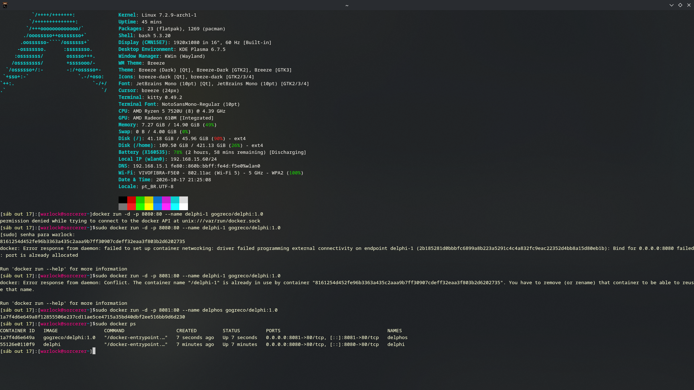

# Delphi

## Autor
Pedro L. R. Greco — Matrícula 22308774

## Descrição
Plataforma simples que resolve as questões mais complicadas da vida humana: respostas de sim ou não, acompanhadas de uma carta de tarot. Na Etapa 02, as respostas podem ser **favoritadas** e ficam guardadas em um banco de dados, e a aplicação foi empacotada em uma imagem Docker.

## API utilizada
- Yes or No API — https://yesnooracle.app/api
- https://yesnooracle.app/api/oracle?tool=tarot

## Funcionalidades
- Escrever uma pergunta a ser respondida pela API;
- Favoritar a resposta recebida (pergunta, veredito, carta e frase);
- Listar "Meus favoritos" ao abrir a página;
- Excluir favoritos;
- Visual simples: fundo roxo escuro, letras claras e texto centralizado.

## Links
- **Repositório GitHub:** https://github.com/GoGreco/delphi
- **Aplicação no ar (GitHub Pages):** https://gogreco.github.io/delphi/
- **Docker Hub:** https://hub.docker.com/r/gogreco/delphi

## Como executar

### Com Docker (recomendado)
```bash
docker run -d -p 8080:80 gogreco/delphi:1.1
```
Depois abra http://localhost:8080.

### Localmente (sem Docker)
1. Clone: `git clone https://github.com/GoGreco/delphi`
2. Sirva a pasta com um servidor estático (ex.: `python -m http.server 8080`) e abra http://localhost:8080. O `main.js` usa módulos ES, então abrir o `index.html` direto por `file://` pode ser bloqueado pelo navegador.

## Persistência de dados

- **Banco escolhido:** Supabase (PostgreSQL), acessado direto do frontend com `supabase-js`.
- **O que é salvo:** as respostas do oráculo que o usuário decide favoritar.
- **Operações:** criar (Favoritar), listar (Meus favoritos, carregado ao abrir a página) e excluir (botão em cada item).

Estrutura da tabela `favoritos` (script completo em [`supabase.sql`](supabase.sql)):

| Coluna      | Tipo        | Descrição                          |
|-------------|-------------|------------------------------------|
| `id`        | bigint (PK) | Identificador automático           |
| `criado_em` | timestamptz | Data/hora do registro (default now) |
| `pergunta`  | text        | Pergunta feita pelo usuário        |
| `veredito`  | text        | yes / no / maybe                   |
| `carta`     | text        | Carta de tarot retornada pela API  |
| `frase`     | text        | Frase interpretativa da carta      |

**Limitação conhecida:** as políticas RLS estão abertas para o papel `anon` (leitura, inserção e exclusão), como permitido nesta etapa. Não há login, então todos os visitantes veem e apagam os mesmos favoritos. A chave `anon public` no código é feita para uso no frontend.

## Docker

Imagem baseada em `nginx:alpine`, servindo `index.html`, `main.css` e `main.js`.

```bash
docker build -t delphi .
docker run -d -p 8080:80 --name meu-app delphi
```

## Sidequests

### SQ1 · .dockerignore
O arquivo `.dockerignore` exclui `.git`, `README.md`, `docs/`, `supabase.sql` e arquivos de editor. Isso deixa a imagem menor, porque nada disso é necessário para servir o site, e o build mais rápido, porque o Docker envia menos arquivos como contexto de build (o histórico `.git` costuma ser a parte mais pesada). Também evita invalidar o cache de camadas quando só a documentação muda.

### SQ2 · Versionamento de imagem
Tags publicadas no Docker Hub: `1.0` (primeira versão com persistência), `1.1` (após a melhoria visual com CSS) e `latest`.

```bash
docker tag delphi gogreco/delphi:1.0
docker push gogreco/delphi:1.0
docker tag delphi gogreco/delphi:latest
```

### SQ3 · Descrição no Docker Hub
O overview do repositório no Docker Hub contém a descrição da aplicação, o comando `docker run` e o link do GitHub. Link: https://hub.docker.com/r/gogreco/delphi

### SQ4 · Explorando a orquestração
Dois containers da mesma imagem rodando ao mesmo tempo:

```bash
docker run -d -p 8080:80 --name delphi-1 gogreco/delphi:1.1
docker run -d -p 8081:80 --name delphi-2 gogreco/delphi:1.1
docker ps
```



**Se eu tivesse 100 containers, como gerenciaria?** Subir e vigiar 100 containers à mão, com `docker run` em cada servidor, seria inviável. É para isso que existe o Kubernetes, um orquestrador que gerencia containers automaticamente. Ele organiza as máquinas em um *cluster* (um conjunto de servidores trabalhando como uma unidade). A menor unidade que ele executa é o *pod*, que agrupa um ou mais containers. Eu declararia quantas *réplicas* do pod quero (por exemplo, 100) e o Kubernetes mantém esse número: se um container cair, ele sobe outro; se a carga aumentar, é possível escalar as réplicas; e ele distribui o tráfego entre elas e faz atualizações de versão gradualmente, sem derrubar o serviço.